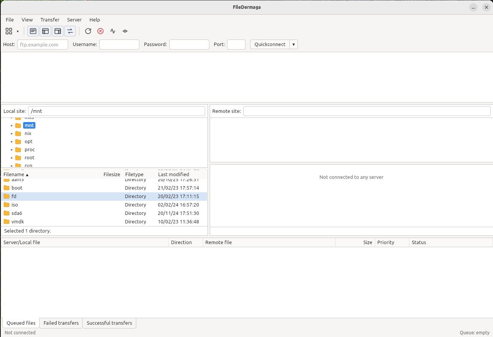

# FileDermaga

**FileDermaga** is a fast, native file transfer client for **FTP, FTPS and Amazon S3 compatible storage**, written in Rust. It comes as a desktop app with a classic two‑pane layout and as a scriptable command line tool.

*Dermaga* is Indonesian for *pier* — the place where cargo moves between land and ship. FileDermaga does the same for your files: between your computer, your servers and your buckets.



## Features

**Protocols**
- FTP with automatic TLS upgrade, explicit FTPS (`AUTH TLS`) and implicit FTPS (port 990)
- Amazon S3 and S3‑compatible services: Backblaze B2, Cloudflare R2, Wasabi, DigitalOcean Spaces, MinIO, …
- Understands the directory listing formats of a wide range of servers: Unix, Windows/IIS, MLSD, EPLF, OpenVMS, IBM i, z/OS, z/VM, OS/2, VxWorks, HP NonStop and more

**Desktop app**
- Local and remote panes, each with a directory tree and a sortable file list
- Drag & drop, double‑click to transfer, context menus and keyboard shortcuts
- Transfer queue with progress, speed, cancel and retry; recursive folder transfers
- Message log with the full protocol conversation
- Site Manager with a **Test connection** button and a quick‑connect dropdown in the toolbar
- Passwords and S3 secret keys are stored in the **system keyring** (GNOME Keyring / Secret Service), never in plain text files
- S3 extras: create buckets, choose storage class and server‑side encryption, generate pre‑signed download links
- Light and dark theme

**Command line**
- `ls`, `get`, `put` (recursive), `mkdir`, `rm`, `rmdir`, `mv`, `chmod`, pre‑signed `url`
- Parallel multipart uploads to S3, progress output, sensible exit codes for scripting

## Installation

### Ubuntu / Debian (.deb)

Download `file-dermaga_<version>_amd64.deb` from the [Releases](https://github.com/aamsur/file-dermaga/releases) page and install it:

```bash
sudo apt install ./file-dermaga_*_amd64.deb
```

Requires **Ubuntu 22.04 or newer** (x86_64). The package installs:

| Path | What |
|---|---|
| `/usr/bin/file-dermaga-gui` | desktop app (also in your application menu as *FileDermaga*) |
| `/usr/bin/file-dermaga` | command line tool |

### From source

```bash
# Build dependencies (Ubuntu 22.04+)
sudo apt install build-essential pkg-config libssl-dev libdbus-1-dev \
  libwebkit2gtk-4.1-dev libgtk-3-dev libsoup-3.0-dev librsvg2-dev

git clone https://github.com/aamsur/file-dermaga.git
cd file-dermaga
cargo build --release -p file-dermaga-cli
cargo build --release -p file-dermaga-gui --features custom-protocol

./target/release/file-dermaga-gui      # desktop app
./target/release/file-dermaga --help   # command line tool
```

A Rust toolchain ≥ 1.85 is required ([rustup.rs](https://rustup.rs)).

## Using the desktop app

- **Quickconnect:** type a host such as `ftp.example.com`, `ftpes://ftp.example.com` or `ftps://…`, plus user name, password and port.
- **Site Manager** (`Ctrl+S`): save connections, then pick them from the **▾** next to the Site Manager button. Use **Test connection** to check host, TLS, login and the start directory before saving. Tick *Save password / secret key* to keep the secret in the system keyring.
- **S3:** choose protocol *S3* in the Site Manager and pick a provider preset (or leave the endpoint empty for AWS). Keys can also come from `~/.aws` profiles or the standard `AWS_*` environment variables.
- **Transfers:** double‑click a file, drag files between the panes, or use the context menu. Folders are transferred recursively.

| Shortcut | Action |
|---|---|
| `F5` | Refresh |
| `F2` | Rename |
| `Del` | Delete |
| `Backspace` | Parent directory |
| `Enter` | Open folder / transfer file |
| `Ctrl+A` | Select all |
| `Ctrl+H` | Show/hide hidden files |
| `Ctrl+S` | Site Manager |
| `Ctrl+D` / `Ctrl+R` | Disconnect / reconnect |

## Using the command line

```bash
# FTP / FTPS
file-dermaga ls -l ftp://user@ftp.example.com/public_html      # asks for the password
file-dermaga put -r ./site ftpes://user@ftp.example.com/www/   # explicit TLS required
file-dermaga get ftps://user@ftp.example.com/backup.tar.gz     # implicit TLS (port 990)

# Amazon S3
file-dermaga ls s3://                                          # list buckets
file-dermaga put --storage-class STANDARD_IA --sse AES256 report.pdf s3://my-bucket/reports/
file-dermaga url --expires 3600 s3://my-bucket/reports/report.pdf

# S3-compatible services
file-dermaga --endpoint https://s3.us-west-000.backblazeb2.com ls s3://my-bucket
file-dermaga --endpoint http://localhost:9000 --path-style ls s3://
```

| URL | Meaning |
|---|---|
| `ftp://[user[:pass]@]host[:port]/path` | FTP, upgraded to TLS when the server offers it (`--plain` to disable) |
| `ftpes://user@host/path` | FTP with explicit TLS required |
| `ftps://user@host/path` | FTP with implicit TLS (port 990) |
| `s3://bucket/key` | S3 bucket and key (`s3://` alone lists buckets) |

Useful options: `-k/--insecure` (accept self‑signed certificates), `-v/--verbose` (protocol log), `--password` or `FILE_DERMAGA_PASSWORD`, and for S3 `--endpoint`/`FILE_DERMAGA_S3_ENDPOINT`, `--region`, `--profile`, `--path-style`, `--storage-class`, `--sse`, `--part-size`, `--concurrency`. Run `file-dermaga --help` for everything.

## Security notes

- TLS certificates are verified against the Mozilla root store. Accepting an untrusted certificate is an explicit choice (`-k` on the command line, a confirmation dialog in the app).
- With plain `ftp://`, FileDermaga upgrades to TLS whenever the server supports it and warns when the connection stays unencrypted.
- Saved passwords and secret keys live in the operating system keyring. The site list (`~/.config/app.file-dermaga.client/sites.json`) never contains secrets.

## Development

```
crates/
  file-dermaga-core      timestamps, directory entries, listing parser (see SPEC.md)
  file-dermaga-ftp       async FTP/FTPS client (tokio + rustls)
  file-dermaga-s3        S3 backend (AWS SDK)
  file-dermaga-transfer  backend-neutral operations and recursive transfers
  file-dermaga-cli       `file-dermaga` command line tool
  file-dermaga-gui       desktop app (Tauri 2, plain HTML/CSS/JS front end)
packaging/               desktop entry and license-notice config for the .deb
tools/                   local test servers
```

```bash
cargo test --workspace                 # unit and integration tests
cargo clippy --workspace --all-targets
tools/test-servers.sh start            # local FTPS/FTP/S3 servers in Docker for manual testing
tools/test-servers.sh stop
```

`tools/test-servers.sh` starts an FTPS server on port 2121, a plain FTP server on 2122 (user `test`, password `test123`) and an S3 emulator on `http://127.0.0.1:9100`.

### Releasing

Publishing a GitHub Release with a tag like `v0.2.0` runs [`.github/workflows/release.yml`](.github/workflows/release.yml): it runs the tests on Ubuntu 22.04, builds the `.deb` and attaches it to the release. Bump `version` in `Cargo.toml` and `crates/file-dermaga-gui/tauri.conf.json` first.

To build the package locally:

```bash
cargo install cargo-deb
cargo install cargo-about --features cli
cargo build --release -p file-dermaga-cli
cargo build --release -p file-dermaga-gui --features custom-protocol
cargo about generate -c packaging/about.toml packaging/about.hbs -o target/release/THIRD-PARTY-LICENSES.html
cargo deb -p file-dermaga-gui --no-build
```

## Roadmap

- SFTP
- Resuming interrupted transfers
- Multiple connections in tabs
- Folder comparison and synchronisation
- Packages for other distributions, macOS and Windows

## License

FileDermaga is licensed under either of

- Apache License, Version 2.0 ([LICENSE-APACHE](LICENSE-APACHE))
- MIT license ([LICENSE-MIT](LICENSE-MIT))

at your option. The licenses of all bundled third‑party components are generated at release time and installed with the package as `/usr/share/doc/file-dermaga/THIRD-PARTY-LICENSES.html`.

Unless you explicitly state otherwise, any contribution intentionally submitted for inclusion in the work by you, as defined in the Apache‑2.0 license, shall be dual licensed as above, without any additional terms or conditions.
